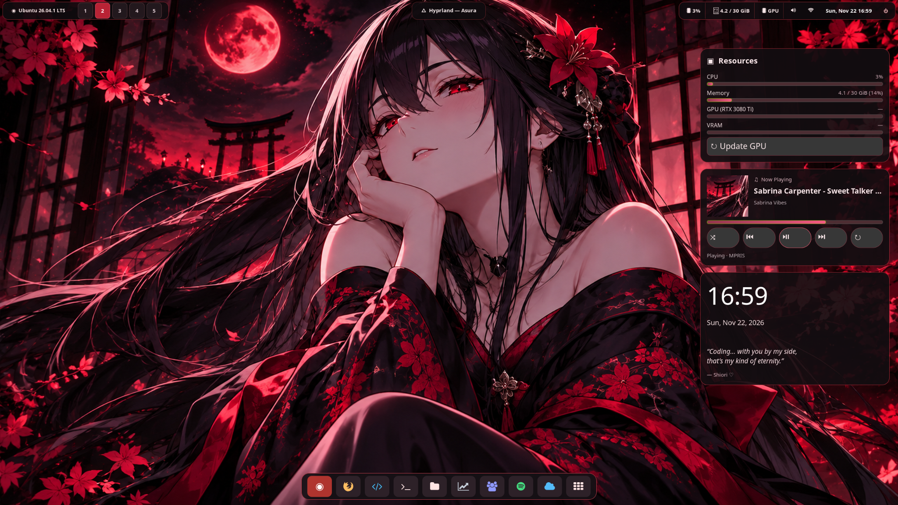

# Shiori Crimson Hyprland ⛩️

> **PUBLIC BETA SOURCE CANDIDATE — NOT STABLE OR ONE-CLICK INSTALLABLE.** This project is experimental, provided **AS IS**, and must be used **at your own risk**. Review the source before running it. **Never copy these templates directly onto your live Hyprland config.**

A crimson-themed Hyprland / Wayland desktop setup featuring a GTK3 layer-shell HUD, application launcher, three Waybar bars, dock-state feedback, power menu and a dual-monitor desktop concept. Developed on Asura (Ubuntu 26.04, Hyprland 0.53.x). Owned/maintained by [Kadantte](https://github.com/Kadantte). Intended public repository: [Kadantte/shiori-crimson-hyprland](https://github.com/Kadantte/shiori-crimson-hyprland).

## Screenshots

A preview of Shiori Crimson running on **Asura**. These are real desktop captures, not installation previews; the appearance and monitor layout may change during beta development.

### Desktop overview

<p align="center">
  
</p>

### Fastfetch system identity

<p align="center">
  
</p>

> **Screenshots and artwork:** These images are supplied to demonstrate the project and include Shiori Crimson character art. Personal, non-commercial desktop use is allowed only as described in the [artwork license](assets/ASSET-LICENSE.md); separate redistribution, commercial use and sale require permission. Third-party logos and icons visible **inside screenshots** retain their respective owners' rights. Screenshots may show developer-specific system information and do not represent universal defaults.

## State of the project

- **Real source imported:** 19 code/config files from the developer's working Asura snapshot, with provenance recorded in [`docs/source-provenance.json`](docs/source-provenance.json).
- **Baseline:** v3.3.3.1 working desktop on Asura. **v3.4 engineering readiness remains open.** Don't interpret this source candidate as a finished v3.4 release.
- **No automated installation:** some files are **templates**, and the HUD/power UI remain partially LG/Asura-specific. The current desktop is *not* modified by extracting the repo or running its static tests.
- **Artwork:** only the two documentation screenshots below are included; deployable wallpaper/character-art binaries are not packaged. Screenshots follow the separate personal/non-commercial image license. Third-party app icons are resolved from installed applications, not redistributed as standalone images.

### Features in the source

| Component | Notes |
| --- | --- |
| Hyprland | Developer's dual-output concepts; monitor connectors/refresh rates and AZERTY are **personal settings**, not defaults for everyone |
| Waybar | Top bars on main/portrait plus bottom application dock with focus/running states |
| HUD | GTK3 / gtk-layer-shell resource/media widgets and search launcher |
| Applications | Gio desktop-entry discovery, Flatpak-aware environment, fast search observed on Asura |
| Icons | Native `Gio.AppInfo` in launcher; cache-only Waybar CSS generated from installed app icons |
| Power menu | Lock/logout/reboot/shutdown with explicit confirmation; **do not test casually** |

## How to inspect safely

```bash
python3 -m unittest discover -s tests -v
python3 scripts/prepublish.py
python3 -m compileall -q src/shiori-v3 scripts
bash -n src/shiori-v3/*.sh src/shiori-v3/start-waybar.sh scripts/helpers/*.sh
```

See [portability and preview rendering](docs/portability.md), [source review findings](docs/2026-11-23-source-review.md), [icon-resolution design](docs/icon-resolution.md), and [installation and recovery](docs/installation.md). The rendering tool creates previews **outside live config** and does not enable or restart anything.

## Important limits

The ASUS Waybar launcher button passed manual click testing, but source inspection shows that the **HUD launcher itself currently targets the LG monitor**. This is not yet a general per-monitor popup solution. Multiple synchronous media subprocess calls may block the UI under stalls; the dock polls multiple scripts every 3 s. Further hardware tests, full installation/rollback design and licensing review are needed before public release endorsement.

## License and intellectual property

- **Original project code/documentation:** MIT, to the extent the maintainer holds the applicable rights. [LICENSE](LICENSE).
- **Original Shiori picture assets:** **All rights reserved with a limited personal, non-commercial desktop-use permission** for individually approved and included files. Selling, monetizing, reselling or independently redistributing them is not permitted without prior express written permission. [Artwork license](assets/ASSET-LICENSE.md).
- **Chrome, Discord, Docker, Spotify and other brand assets:** remain the property of their respective owners, and may be loaded from their installed apps. **Not bundled, sublicensed, or covered by MIT.** See [brand notices](assets/THIRD-PARTY-NOTICES.md).
- **Fonts and third-party code:** retain their original terms. [License review](docs/licensing-review.md).

This repository is an independent desktop customization. It does not claim sponsorship, endorsement or affiliation with Google, Discord, Docker, Spotify, Canonical, or the Hyprland maintainers. This Linux project is separate from the Shiori Windows anime/manga application.

**Beta safety:** Test in a spare account/VM with TTY recovery before attempting any real install. Keep known-good backups, avoid forceful compositor changes, and do not run `activate.sh`, `restore.sh`, power actions or a cursor-reset utility merely to inspect this repository.
